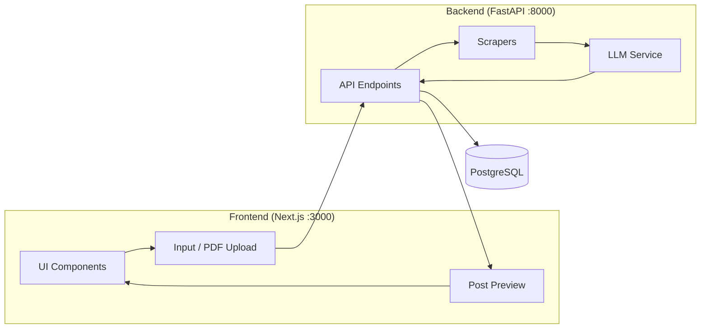

# AI Knowledge-to-LinkedIn Content Engine

A **single-page web app** that extracts insights from YouTube videos, articles, PDFs, or Markdown files and generates premium LinkedIn-ready posts using LLMs via [OpenRouter](https://openrouter.ai/).



---

## ✨ Features

- **Source flexibility** — paste a YouTube URL, article URL, PDF URL, or upload a local PDF
- **Fast extraction** — `pypdf` for PDFs, `newspaper3k` for articles, custom YouTube transcript handling
- **AI-powered writing** — powered by OpenRouter (NVIDIA Nemotron 120B primary, GPT-OSS 120B fallback)
- **Retry logic** — automatic exponential backoff on transient LLM errors
- **Input guards** — PDF uploads capped at 10MB, transcripts capped at 8,000 tokens pre-LLM
- **Rate limiting** — 20 generations/hour per user (in-memory)
- **Token tracking** — input/output token counts stored per generation in DB
- **Request logging** — every HTTP request logged with method, path, status, duration via loguru
- **Auth** — JWT access + refresh tokens in HttpOnly cookies, with rotation and reuse detection
- **Streaming** — posts stream token-by-token (NDJSON) instead of blocking the request
- **3 versions** — optionally write three posts with different hook styles and pick one
- **Edit & refine** — edit any saved post, or ask the AI to rewrite it ("Shorter", "More casual", or your own instruction)
- **Your voice** — paste past posts in Settings and the AI matches their style
- **Scrape cache** — re-using a URL you already scraped skips the download
- **Modern UI** — glass-morphism cards, dark theme, micro-animations

---

## 🛠️ Tech Stack

| Layer | Tech |
|-------|------|
| Backend | **FastAPI** (Python 3.13) — `uvicorn` |
| Database | **PostgreSQL 16** — `asyncpg` |
| Scrapers | `pypdf`, `requests`, `newspaper3k`, custom YouTube logic |
| LLM Service | OpenRouter via `openai` SDK — `tenacity` retry, `tiktoken` token counting |
| Logging | `loguru` — request middleware + structured logs |
| Frontend | **Next.js** + **Tailwind CSS** |
| Packaging | `uv` for Python, `npm` for the UI |

---

## 📦 Getting Started (Local Dev)

### Prerequisites
- **Python 3.13+** and **uv**
- **Node.js 20+** and **npm**
- **PostgreSQL** running locally
- An [OpenRouter](https://openrouter.ai/) API key

### 1. Environment

```bash
cp .env.example .env
# Edit .env — set OPENAI_API_KEY, JWT_SECRET, DATABASE_URL
```

### 2. Backend

```bash
uv sync
uv run uvicorn main:app --reload
# Runs on http://127.0.0.1:8000
```

### 3. Database (first run)

```bash
# Apply schema to your local Postgres. The file is idempotent: re-run it
# to upgrade an existing DB (it adds refresh_tokens and new columns if missing).
psql $DATABASE_URL -f db/schema.sql
```

### 4. Frontend

```bash
cd frontend
npm install
npm run dev
# Runs on http://localhost:3000
```

---

## 🐳 Docker (full stack)

```bash
cp .env.example .env
# Edit .env — set OPENAI_API_KEY and JWT_SECRET
# Leave DATABASE_URL host as 'db' for Docker networking

docker compose up -d
# API: http://localhost:8000
# DB:  localhost:5432
```

`docker compose down -v` to tear down including the DB volume.

---

## 🔍 Observability

**Health check:**
```bash
curl http://127.0.0.1:8000/health
# {"status": "ok", "database": "connected"}
# Returns 503 if DB is unreachable
```

**Live request logs** (tail server output):
```
2026-06-04 02:47:41 | INFO | GET /health 200 1ms
2026-06-04 02:47:42 | INFO | POST /api/generate/linkedin-post 200 65732ms
```

---

## 📤 PDF Upload Flow

1. Switch input mode to **Upload PDF** (toggle button)
2. Choose a local `.pdf` file — max **10MB**
3. File sent as `multipart/form-data` to `/api/scrape/pdf-upload`
4. Backend extracts text via `PdfScraper.scrape_bytes` and returns it
5. Content is fed to the LLM to generate the LinkedIn post

---

## 📚 API Reference

| Endpoint | Method | Body | Returns |
|----------|--------|------|---------|
| `/health` | GET | — | `{"status": "ok", "database": "connected"}` |
| `/auth/register`, `/auth/login` | POST | `{email, password}` | Sets `access_token` + `refresh_token` cookies |
| `/auth/refresh` | POST | — (refresh cookie) | Rotates both cookies |
| `/auth/logout` | POST | — | Revokes the session, clears cookies |
| `/api/scrape` | POST | `{"url": "<source>"}` | `{"content", "source_type", "metadata"}` (`metadata.cached` when served from cache) |
| `/api/scrape/pdf-upload` | POST (multipart) | `file` (PDF ≤ 10MB) | Same as above, `source_type` always `"pdf"` |
| `/api/generate/linkedin-post` | POST | `{"transcript", "creative_direction"?, "variants"?: 1-3, "source_url"?, "source_type"?}` | NDJSON stream (see below) |
| `/generations` | GET | — | List of past generations |
| `/generations/{id}` | GET / PATCH / DELETE | PATCH: `{"generated_post"}` | Generation object / 204 |
| `/generations/{id}/status` | PATCH | `{"status": "draft\|published\|archived"}` | Generation object |
| `/generations/{id}/refine` | POST | `{"instruction"}` | NDJSON stream; the rewrite replaces the saved post |
| `/profile` | GET / PUT | `{name, job_title, niche, tone, linkedin_headline, bio, sample_posts}` | Profile object |

Streaming endpoints send one JSON object per line: `{"delta": "..."}` for each text chunk, then
`{"done": true, "model_used", "generation_ids" | "generation_id"}`, or `{"error": "..."}` if generation fails mid-stream.
With `variants > 1`, versions are separated by a `---VARIANT---` line.

Rate limit: **20 generations/hour** per authenticated user.

---

## 📄 License

MIT
